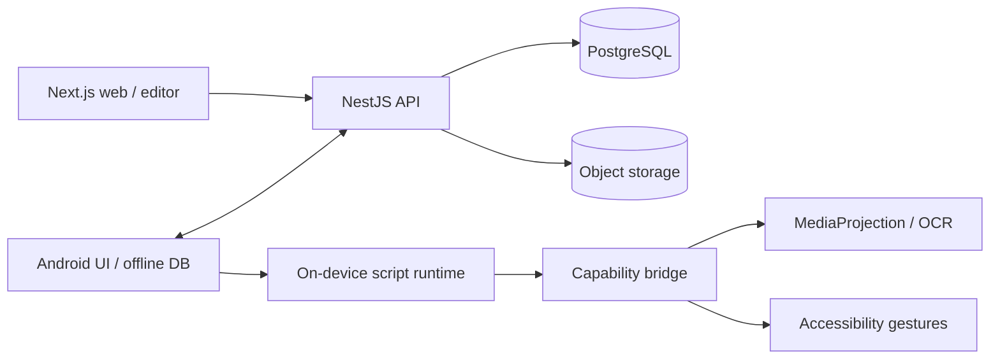
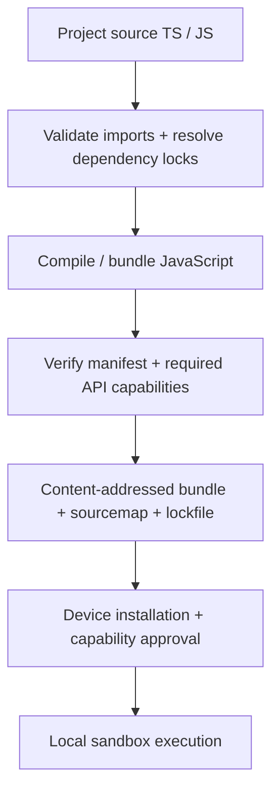

# TapScript — Technical Architecture (Draft)

**Status:** Proposal v0.1 — not approved  
**Date:** 2026-10-31  
**Dependencies:** `PRD.md`; ADRs required for runtime sandbox, compiler, auth/session, and distribution.

## 1. Recommended architecture at a glance

A hybrid monorepo with **three independently built applications**:

- `mobile`: native Kotlin/Compose Android client, on-device execution, OCR/capture/gestures and local persistence.
- `web`: Next.js (TypeScript) editor, management and community UI.
- `api`: NestJS (TypeScript) modular monolith for identity, projects, publishing, sync, discovery and moderation.

**Clarification:** NestJS is a backend framework; the recommended web frontend is **Next.js**, not a second NestJS application. Both live in the same workspace without conflating runtime concerns.



### Ownership

| Concern | Owner |
|---|---|
| Live touch/screen/OCR | Android device only |
| Local code bundle installation and runtime | Android |
| Web editor UI | Web |
| Private project source and revisions | API + local cache/sync |
| Immutable releases and dependencies | API + object store, cached locally |
| Users, sessions, moderation, public catalog | API |
| Script SDK contract/definitions | Shared versioned package; Android host must implement contract |
| Auth tokens and consent | Dedicated session and local capability layers |

No backend is required to interpret every loop iteration, tap, or OCR result. Device continues operating during cloud outages.

## 2. Proposed repository layout

```text
TapScript/
├── .github/
│   └── workflows/                 # android.yml, web.yml, api.yml, security.yml
├── apps/
│   ├── mobile/                    # Standalone Gradle root
│   │   ├── app/                   # Android application, Compose shell
│   │   │   └── src/...
│   │   ├── gradle/
│   │   ├── settings.gradle.kts
│   │   ├── build.gradle.kts
│   │   ├── gradle.properties
│   │   ├── gradlew
│   │   └── gradlew.bat
│   ├── web/                       # Next.js frontend
│   └── api/                       # NestJS modular monolith
├── packages/
│   ├── contracts/                 # OpenAPI schema + generated API clients/types
│   ├── script-sdk/                # Versioned script host API and .d.ts
│   ├── script-compiler/           # TS/JS import resolver, bundler, manifest
│   └── shared-config/            # Optional lint/TS config (create on demand)
├── infra/                         # Local Compose, deployment templates
├── docs/
│   ├── PRD.md
│   ├── ARCHITECTURE.md
│   └── adr/
├── pnpm-workspace.yaml            # Includes web/api/packages; excludes Gradle root
├── package.json
├── pnpm-lock.yaml
├── .editorconfig
├── .gitignore
└── README.md
```

Do **not** create unnecessary Android modules before a vertical slice proves the boundaries. Later split `apps/mobile` internally into `runtime-api`, `runtime-core`, `platform-android`, `recognition-mlkit`, `scripting-*`, `storage-room` as dependencies stabilize.

**Toolchain choice:** pnpm workspaces for TS; standalone Gradle build rooted at `apps/mobile`. Root scripts orchestrate build/test/lint, but Node tooling must not be a prerequisite for Android IDE sync or local native development. Do not force the Android project into the Nest CLI monorepo model.

## 3. Android architecture

```text
Compose UI / ViewModels
        ↓
Use cases (project, editor, install, run, pause, logs, sync)
        ↓
Domain/ports (Runner, ScriptStore, TargetResolver, Capture, Gesture, OCR)
        ↓
Adapters: Room, JS sandbox, AccessibilityService, MediaProjection, ML Kit, API
```

### Android-owned components

- **UI:** Compose navigation, editor integration, permission onboarding, visual picker, live state/logs.
- **Project storage:** Room/SQLite for local source metadata, installed releases, target packs, cache and execution state. Asset files reside in app-private storage; ensure atomic write and hash validation.
- **Runtime controller:** one explicit state machine `Idle → Preparing → Ready → Running ↔ Paused → Stopping → Completed/Failed`; cancellation is propagated to the JS host and all native actions.
- **Capture:** Android MediaProjection foreground service, frame leases and ROI-aware recognition; handles projection revocation, screen resizing, rotation, insets and black/protected content.
- **Interaction:** `AccessibilityService` adapter with `dispatchGesture`; semantic element actions only where the OS permits; no reflection into arbitrary apps.
- **Recognition:** OCR and future template/color/element recognizers behind typed ports, with timeouts, frame cache and confidence metadata.
- **Script execution:** sandbox with capability-only bridge; no direct Android/Java objects, reflection, arbitrary network or storage.
- **Sync:** incremental background exchange of user-authored data when authenticated; conflict resolution separated from runtime.

**Important:** the existing Rhino engine is a one-shot command emitter. It does not yet implement a robust hostile-code sandbox, ECMAScript module graph or asynchronous interactive host-bridge semantics. It is not the target long-term runtime without a formal spike and hardening.

### JavaScript runtime spike (ADR required)

Candidates to evaluate: **QuickJS** (native embed), alternative embedded JavaScript runtimes, and retaining Rhino only if security and language requirements can be proven. The architectural choice is **sandbox interface**, not a hard dependency on a named engine today.

Prototype must demonstrate:

1. Standard `async/await`, Promise scheduling and ES module import semantics.
2. Native asynchronous host request/response bridge for OCR, gesture and waiting.
3. Forced cancellation of infinite loops and stalled async operations.
4. CPU/memory/time limits, low-level sandbox isolation and resilient process restart.
5. Resource footprint/ABI packaging and minimum supported Android devices.
6. No Java/Android/host-object or unrestricted filesystem/network escape.
7. Error stacks/source maps, isolated per-run state and unit-test harness.

Do **not** claim a pure in-process interpreter is a hardened sandbox for community code until threat-model and isolation tests have passed. Explore a separately isolated Android process with narrow IPC, but validate Android lifecycle and permission constraints in the spike.

## 4. Script SDK contract

Scripts should receive a context object rather than global platform functions. This creates a namespace for API evolution and makes per-run capabilities visible.

**Illustrative API; not a finalized signature:**

```typescript
import type { TapScriptContext } from '@tapscript/sdk';
import { randomDelay } from './lib/timing';

export async function main(ctx: TapScriptContext): Promise<void> {
  const text = await ctx.ocr.read({ region: 'item-stats' });
  if (text.text.includes('Legendary')) {
    await ctx.gestures.tap({ target: 'keep-button' });
  } else {
    await ctx.gestures.tap({ target: 'sell-button', jitterPx: 2 });
  }
  await randomDelay(ctx, 150, 250);
}
```

A native Android `TapScriptContext` host adapter fulfills versioned method names, argument schemas, error codes and permissions. `@tapscript/sdk` is a **type/interface authoring package**, not Node.js code executed inside Android. Runtime may expose a small JS shim for ergonomic calls.

Principles:

- Every API operation is structured, async where meaningful, cancellable and permission-checked.
- Versioned `SdkVersion` / `EngineVersion` compatibility gate; no reliance on accidental JS global objects.
- Stable semantic slugs for targets, screen regions and assets; resolve through explicit packs.
- Error codes include `TARGET_NOT_FOUND`, `CAPABILITY_DENIED`, `CAPTURE_UNAVAILABLE`, `APP_NOT_VISIBLE`, `TIMEOUT`, `SCRIPT_CANCELLED`, `INCOMPATIBLE_RUNTIME`.
- Randomization is bounded, auditable and optionally seeded for replay/testing; never used to evade platform security.
- Script packages cannot call internal HTTP endpoints or hold first-party session tokens.

## 5. Source imports, build and release



- Authoring supports relative imports for project files and namespaced imports for versioned library releases.
- The builder constructs an exact dependency graph (hash + version), bundles all runtime modules and emits source maps.
- `latest` cannot be used as an unpinned execution dependency; transitive dependency integrity checks are required.
- Publishing creates a frozen release: `source_hash`, `bundle_hash`, manifest, compiled entrypoint, lockfile, capability manifest and SDK range.
- Runtime never evaluates an arbitrary URL import. Untrusted third-party dependencies are included within the same sandbox budget.
- **Offline compiler question:** web/API can run the same TypeScript toolchain. For Android offline editing + compilation, benchmark an embedded compiler (e.g. restricted local WebView/WASM-based compiler) rather than promising identical output without tests. Offline execution of cached compiled releases is independent of this decision.

## 6. Targets and geometry

Target definitions have:

```text
id: UUID
slug: 'sell-button'
kind: POINT | RECTANGLE | SWIPE_PATH | IMAGE_TEMPLATE
frame: DISPLAY | APP_CONTENT | RECOGNIZED_ANCHOR
geometry: normalized points / bounding boxes + optional anchor
referenceDevice: dimensions, orientation, density, insets
confidence/threshold: recognizer-specific
version: schema version
```

A `TargetResolver` converts logical space to **actual gesture/capture coordinates** in a single tested adapter. It must handle mismatched screenshot sizes, virtual display crop, density, status/navigation bars, cutouts, display rotation and split-screen. Never assume `x * screenWidth` maps perfectly from captured pixels to touch coordinates.

Reusable target packs may be imported by multiple scripts; per-device overrides are explicit. Missing/ambiguous targets fail closed with a useful error and visual preview.

## 7. Backend architecture: NestJS modular monolith

Suggested modules:

- `AuthModule`: Google OIDC identity, token validation, first-party sessions, login/link/logout, session/device revoke.
- `UsersModule`: profile and privacy/export/deletion.
- `ProjectsModule`: ownership, mutable drafts, source files, revisions, optimistic concurrency.
- `ScriptsModule`: runnable script metadata, validation/compilation requests.
- `PackagesModule`: library namespaces, releases and dependency resolution.
- `ReleasesModule`: immutable script bundles, lock manifests, integrity and compatibility.
- `AssetsModule`: images/templates/metadata, pre-signed object storage access with content validation.
- `SyncModule`: revision-based incremental device synchronization, idempotency.
- `DiscoveryModule`: public/unlisted catalogs, search and bookmarks.
- `ModerationModule`: reports, takedown and audit records.
- `DevicesModule`: device metadata, installation state; future optional explicit-confirmation pairing.

**Initial infrastructure:** PostgreSQL; S3-compatible object storage for bundles/screenshots/assets. Start without Redis, BullMQ, message broker, microservices or a separate auth server until justified. For an ORM choose Prisma or another mature typed option via a short ADR, never leak persistence types through domain/API contracts. Add transactional outbox and workers only when real asynchronous workloads demand them.

### API design

- Resource-oriented REST and **OpenAPI as source of the typed client contract**; generate SDK/client and check diff in CI.
- Standard errors (`code`, `message`, `details`, `requestId`); version the public API and script SDK separately.
- Authorization for every resource (`owner`, collaborator roles later, visibility, release install rights).
- ETag/version-based writes, idempotency keys for publication/upload actions, pagination, rate limiting.
- Signed upload/download URLs for large assets, with content-type and size limits and checksum validation.
- Data lifecycle, retention and delete/export hooks designed before storing private screenshots.

## 8. Authentication and sessions

- **Android:** Credential Manager Google Sign-In; send Google ID token via TLS to the NestJS API; verify issuer, audience, expiry and Google signing keys on the server. Exchange for **TapScript-owned** session credentials.
- **Web:** browser-mediated OAuth/OIDC Authorization Code + PKCE or an appropriately designed server-side BFF flow; prefer secure httpOnly cookie session with CSRF protection. Do not embed client secret in browser/mobile.
- Store identity using Google `sub` and issuer, with account linking modeled separately. Never use email as a primary key.
- Short-lived tokens, revocable refresh/session family (if chosen), device listing/logout, secure storage on Android, no script access to tokens.
- Guest device work requires merge/import decision when the user signs in.

## 9. Public script threat model

Trust boundaries:

1. **Public author ↔ platform:** source/metadata/assets are untrusted, including imports.
2. **Script ↔ Android:** host bridge must grant only minimal capabilities.
3. **Device ↔ server:** authenticated sync can be maliciously shaped; never execute server content as privileged app code.
4. **Editor ↔ source:** display scripts as code (escaped), never inject them into the site's DOM or origin.
5. **Web ↔ device:** editing permissions do not imply unattended execution permissions.

Required controls before public publishing:

- No reflection/native extension/network/filesystem escape from script VM.
- Enforced CPU, memory, action rate, execution deadlines and cancellation.
- Permission manifest and user approval, including re-approval on newly requested capabilities.
- Integrity-verified immutable release and dependency locks.
- Content safety reporting/moderation; malware/abuse telemetry without screenshots by default.
- Prevent screenshots or OCR from being automatically exfiltrated by public scripts.
- Device-visible run notification/status and unconditional local stop action.

The Android implementation must also honor Google Play restrictions for AccessibilityService and MediaProjection. A sideloaded APK avoids Play review but not OS permissions or platform constraints.

## 10. Testing and CI/CD

### Base CI

- `mobile`: Gradle sync-compatible standalone project; static analysis, JVM tests, Android lint, debug APK, signed/unsigned release logic as configured; instrumented tests added for platform behavior.
- `web`: lockfile install, format/lint, typecheck, unit tests, production build.
- `api`: format/lint, typecheck, unit + integration tests using disposable PostgreSQL, OpenAPI contract snapshot, production build.
- `script-sdk/compiler`: compatibility fixtures, import resolver, reproducible bundle tests, source maps, invalid dependency and malformed manifest cases.
- Repository: dependency/security audit, secret scanning, PR checks, build artifacts and cache keyed by toolchain/lockfiles.

**CI behavior:** changing Android paths must not silently skip Android checks; root config/workflow changes must trigger affected jobs. Preserve artifacts, version identifiers, signing documentation and a stable release process.

### Cross-platform acceptance suite

- Script fixture bundles generated from SDK types → Android simulated host → runtime tests.
- Integration tests for `tap`, `swipe`, `wait`, OCR, unbounded loop cancellation, failed Android permissions, rotation mapping.
- API authorization matrix, cross-account access denial, release immutability and sync conflict tests.
- Threat-model tests for hostile imports, memory/CPU exhaustion and invalid native bridge calls.

## 11. ADR register

| ADR | Decision | Gate |
|---|---|---|
| 0001 | Monorepo + native Android + Next.js + NestJS | Before bootstrap |
| 0002 | Script language, public SDK and module semantics | Before runner |
| 0003 | JS engine and sandbox/isolation | Before untrusted scripts |
| 0004 | Offline compilation scope | Before mobile editor |
| 0005 | Google OIDC and session architecture | Before auth |
| 0006 | Local data model, sync conflicts, ownership | Before sync |
| 0007 | Release immutability, dependency resolution and signatures | Before publishing |
| 0008 | Android distribution and Accessibility/MediaProjection compliance | Before release |
| 0009 | Target/region coordinate geometry and override strategy | Before picker |
| 0010 | Public content safety, moderation and data lifecycle | Before marketplace |

## 12. Principles against premature complexity

- One API, not microservices; one repository, not Git submodules.
- One versioned script host API; no platform-specific JS fork.
- Begin with one Android app module after cleanup, extract only proven boundaries.
- Build an end-to-end vertical slice before designing a plugin marketplace, collaborative editor or runtime scheduler.
- Do not optimize OCR/recognition until benchmarks expose bottlenecks.
- No speculative queues, event buses, cache clusters or event sourcing.
- Every new abstraction should express a current boundary, enforce a security invariant or enable a real test.

## 13. Updated architecture guidance (2026-10-31)

- **Publication unit:** Prefer a **project** containing one or more TS/JS modules, images, target/region definitions, dependencies, metadata and a versioned entry point. This supersedes the earlier script-as-publishable-unit draft, pending formal acceptance.
- **Screen definitions:** Store points, areas and templates as validated serialized project assets. Offer generated, strongly typed TS exports (e.g. `import { ItemStats } from './screen/regions'`), rather than requiring arbitrary executable classes to describe coordinate data. The host SDK resolves these objects at runtime; project assets must not silently gain privileges.
- **Script runtime:** Compare QuickJS/Rhino and other viable engines in a measured Android spike. TypeScript is a source language, not a runtime. For untrusted community content, explicitly prove interruption, cancellation, resource bounds, Java/Android bridge isolation and capability enforcement before release.
- **Backend-driven evolution:** Model compatibility negotiation (API version, runtime version, SDK version, capabilities) separately; server-managed policy/config is not a substitute for Android feature updates.
- **Distribution:** GitHub Releases and Google Play are desired; define channel policy and build/signing flow in an ADR. Google Play scrutiny applies even to user-authored automation scripts.
- **Next.js:** Evaluate static export first, with all business logic and authenticated API operations owned by NestJS; retain the option for a Next.js runtime only when necessary.
- **Current stage:** Repository layout is a foundation only. Web/api directories are intentionally placeholders until implementation decisions are accepted.
